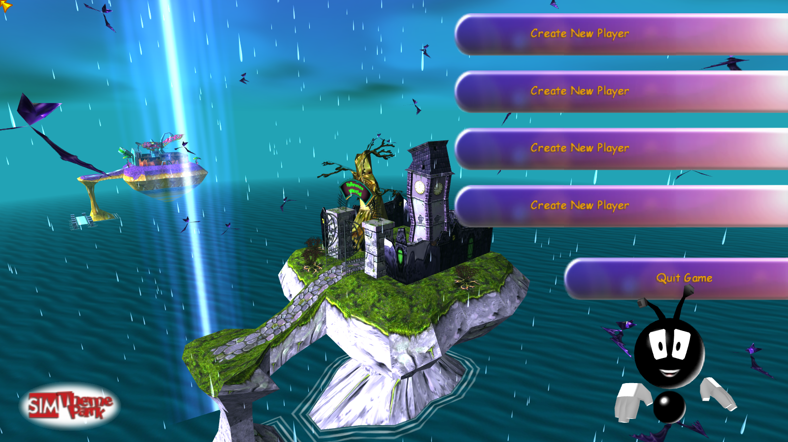

<p align="center">
    <h1 align="center">
        OpenTPW
    </h1>
    <p align="center">
        An open-source re-implementation of <a href="https://en.wikipedia.org/wiki/Theme_Park_World">Sim Theme Park / Theme Park World</a>.
    </p>
    <p align="center">
        <b>OpenTPW</b> · <a href="https://github.com/maexah/OpenTPW.FileFormats">File Formats</a> · <a href="https://maexah.github.io/OpenTPW/">Website</a>
    </p>
</p>



## What this is

OpenTPW re-implements the engine of Theme Park World (1999) so it runs on modern computers. It reads the data files from your own copy of the game - models, textures, sounds, fonts and saves - and draws them with Vulkan.

**You need your own copy of the original game.** This repository ships no game content.

## Can I play it yet?

**Not yet.** OpenTPW is a work in progress. What works today:

- **The lobby works.** The four islands, the front end, the advisor, weather, the options screen and your saved players.
- **Lost Kingdom runs.** Instant Action starts the park the game ships, already built. Full Simulation starts it as an empty park. Guests arrive, queue, ride and buy things. Most of its rides, shops and sideshows run.
- **You can build and manage.** Buy, sell and move rides, lay paths and queues, hire, train and place staff, set the entry price and research new rides.
- **Saving works.** Save, Load, Restart Park and the quicksave keys. A Full Simulation park started empty is saved too. Not saved yet: karts, water rides and track rides bought in a park.
- **Not built yet:** loans, litter, and a park ending when the money runs out. The other three islands are not worked on yet.

[`docs/STATUS.md`](docs/STATUS.md) lists everything that works and everything that does not.

To play the original game on Linux, [`tools/play-the-original`](tools/play-the-original/README.md) sets it up with
Proton. You need your own disc and your own no-CD `.exe`.

### Which version of the game?

OpenTPW is tested only with the **American release, Sim Theme Park**. Theme Park World, the release sold elsewhere, uses the same engine and data and **should** work, but is untested. If you try it, please report how it goes.

## Download

Experimental test builds for Windows, Linux and macOS are published as pre-releases on the
[Releases page](https://github.com/maexah/OpenTPW/releases). Each zip holds a README that says how to start it. The
macOS builds are untested. You still need your own copy of the game.

## Build it yourself

Wanting to change something? [`CONTRIBUTING.md`](CONTRIBUTING.md) has a quick start for Linux, macOS and Windows, and says what needs the game and what does not.

1. Install the [.NET 10 SDK](https://dotnet.microsoft.com/download/dotnet/10.0).
2. Copy your game disc to a folder - see [Getting the game's files](#getting-the-games-files).
3. Build and run:

```sh
dotnet build source/OpenTPW.sln
dotnet source/OpenTPW/bin/Debug/net10.0/OpenTPW.dll --game "/path/to/Sim Theme Park"
```

The build includes every library OpenTPW needs. You may also need a **Vulkan driver**. On Windows and macOS your graphics driver already provides it. On Linux, install your distribution's Vulkan loader (`libvulkan1`, `vulkan-loader` or `vulkan-icd-loader`, depending on the distribution) and Mesa or your GPU vendor's driver.

## Getting the game's files

1. Put the game disc in your computer. If you have a disc image (an `.iso` file), double-click it instead.
2. Open the disc in your file manager, the same way you open any folder.
3. Copy **everything** on it into a new folder, for example `Sim Theme Park` in your Documents.
4. Start OpenTPW and give it that folder, as in [Build it yourself](#build-it-yourself). Put the folder's name in quotes.

If OpenTPW says the file names **"have been cut short"**, the copy went wrong. Delete the folder and copy the disc
again by dragging the files in your file manager.

If OpenTPW says it **cannot find the game**, check the folder you gave it. It lists every folder it looked in.

<details>
<summary>For technical users</summary>

**File names.** A CD holds two sets of file names. The short set is uppercase and cut to eight letters
(`CHALLE~0.SAM` instead of `Challenges.sam`), and the game cannot use it. Mount the disc and copy from the mount, or
use a tool that keeps the long (Joliet) names.

**Where OpenTPW looks.** A folder counts as the game when it has a `data` folder with `levels` inside it, in any
capitalisation. OpenTPW tries, in order: `--game` on the command line, `OPENTPW_GAME_PATH`, the `GamePath` setting
if you have changed it, the folder the build sits in, the working directory, and then, on Windows, the folder the
game's uninstall entry in the registry names (`Theme Park World` or `SimTheme Park`), the original's default
`C:\Program Files (x86)\Bullfrog\Theme Park World` and Sim Theme Park's `C:\Program Files (x86)\SimTheme Park`.
It does not search parent folders.

**Saves** go to `save/` beside the game's data, where the original keeps them, so the original and OpenTPW share
options and players.

If `save/` cannot be written (a game installed under `Program Files` that your account may not change), OpenTPW keeps
its saves in `save` in your own data folder instead (`%AppData%\OpenTPW\save` on Windows, `~/.local/share/OpenTPW/save`
on Linux, `~/Library/Application Support/OpenTPW/save` on macOS) and plays as usual; `console.log` says which folder it
chose. This is a deviation from the original, which would keep them in the game's folder. The test is a file really made
there, so a folder you can write is kept. A `save/` that already holds players but cannot be written is read by nothing:
the players in it are not copied (Q902 is open), and the game says so once on screen. Where that folder cannot be
written either, the game still runs and says on screen when a save, the options or a player is lost: a box reading
`PARK NOT SAVED`, `OPTIONS NOT SAVED` or `PLAYER NOT SAVED`, with the path of `console.log`.

</details>

## Controls

| Key | Does |
|-----|------|
| `Escape` | Game menu - or, in a park, first let go of what you are holding, or leave the ground view |
| `Ctrl`+`H` | Show or hide the help bar |
| `F2` | Hide the interface |
| `X` | Freeze the lobby camera |
| `[` `]` | Move between islands |
| `W` `A` `S` `D` | Move the park camera |
| `←` `→` | Turn the park camera |
| Mouse wheel | Zoom the park camera |
| `C` | In a park: walk on the ground and look around, and back again |
| `B` / `H` | Buy screen / hire screen |
| `O` / `E` / `V` | All rides and shops / all staff / all visitors |
| `Space` | Park map |
| `Ctrl`+`S` / `Ctrl`+`V` | Find a member of staff / find a visitor |
| `Alt`+`S` / `Alt`+`L` | Quicksave / quickload |

`O` and `E` differ from the original game, which uses `A` and `S`: here those move the camera.

## Platforms

| Platform | Builds | Runs |
|----------|--------|------|
| Linux x64 | ✅ | ✅ Developed and tested here |
| Linux arm64 | ✅ | ❔ Never run |
| Windows x64, arm64 | ✅ | ❔ Not run recently |
| macOS Intel, Apple Silicon | ✅ | ❔ Never run |

Every platform draws with Vulkan; on macOS through MoltenVK, which ships with the build. Only Linux x64 is tested. Bug reports from other platforms are very welcome.

**Two graphics cards (a built-in GPU and a graphics card).** OpenTPW lists the Vulkan devices in `console.log` (the `Graphics card:` lines) and draws with a discrete card in preference to a built-in one; the `GPU:` line names the one in use. To choose another, put a line in `save/opentpw.cfg`: `gpu GTX 1650` (the first card whose name holds that text), `gpu #1` (the second card of the logged list) or `gpu auto` (the default). The Options screen's Video Card row is the original's own Primary or Secondary: Primary is the card above, Secondary the next one (offered only where there is more than one card), and it is drawn on from the next start. `gpu` names a card exactly and wins over the row; that line is OpenTPW's own. Two cards of one maker (an AMD built-in GPU beside a Radeon, an Intel one beside an Arc) cannot be told apart on Windows: the log warns and the first device is drawn on.

<details>
<summary>Linux on Wayland</summary>

The SDL that ships with OpenTPW has no Wayland backend, so it runs through XWayland. Scaling and input then differ a little, and without XWayland it does not start. To use your distribution's SDL2 instead:

```sh
OPENTPW_SYSTEM_SDL=1 dotnet source/OpenTPW/bin/Debug/net10.0/OpenTPW.dll --game "/path/to/Sim Theme Park"
```

</details>

## Troubleshooting

**"Theme Park World was not found."** Check the folder you gave OpenTPW - see [Getting the game's files](#getting-the-games-files).

**"its names have been cut short."** The disc was copied without its long file names. Copy it again - see [Getting the game's files](#getting-the-games-files).

**It stops before a window appears, saying it could not load a native library.** Install your distribution's Vulkan loader and your GPU's driver.

**On Wayland the window scales oddly, or SDL says "No available video device".** Install XWayland, or see [Linux on Wayland](#platforms).

**No sound.** Not fatal - OpenTPW warns and carries on.

**A start that fails.** When OpenTPW cannot find the game, a message box says where it looked and how to put it right.
If something else goes wrong before the game's main loop begins, the box names the error. Either box says where the log
is, and OpenTPW then exits. With no display there is no box, only the log and the terminal. The original had no such box
(a deviation). The Windows download opens no terminal window of its own.

**Reporting a problem.** Every start writes `console.log` in the game's folder, beside `save`. If the game's folder cannot be
written, or OpenTPW cannot find the game, it is in your own data folder instead (`%AppData%\OpenTPW` on Windows,
`~/.local/share/OpenTPW` on Linux, `~/Library/Application Support/OpenTPW` on macOS). It names the build, your system
and your graphics card. Your home folder is written as `~` in it, but read it before you attach it to a public page.
[Open an issue](https://github.com/maexah/OpenTPW/issues) and attach it.

## For developers

```sh
dotnet build source/OpenTPW.sln
dotnet test source/OpenTPW.sln
```

Most tests read the real game files and skip when the game is not found; set `OPENTPW_GAME_PATH` to run them all.

<details>
<summary>Launch options and the debug console</summary>

**Launch options**

| Option | Does |
|--------|------|
| `--game <folder>` | Use the game in this folder. `--game=<folder>` also works. |
| `OPENTPW_GAME_PATH=<folder>` | The same, as an environment variable. |
| `OPENTPW_SYSTEM_SDL=1` | Use your system's SDL2 instead of the one in the build. |
| `OPENTPW_DEBUG_CONSOLE=1` | Turn on the debug console. |
| `OPENTPW_LOG_DIR=<folder>` | Write `console.log` there instead of the game's folder. |
| `OPENTPW_NO_MESSAGE_BOX=1` | Do not show the message box of a failed start (a script that fails a start on purpose). |
| `OPENTPW_PROFILE=1` | Log the frame time, frames a second and memory use every 120 frames. |
| `OPENTPW_TEXT_CENSUS=1` | Log every piece of interface text with its drawn size and box. |

**Opening the debug console.** Start OpenTPW from a terminal with `OPENTPW_DEBUG_CONSOLE=1` set, then type commands
into that terminal and press Enter. Every reply starts with `[dbg]`.

```sh
OPENTPW_DEBUG_CONSOLE=1 dotnet source/OpenTPW/bin/Debug/net10.0/OpenTPW.dll --game "/path/to/Sim Theme Park"
```

On Windows, run `set OPENTPW_DEBUG_CONSOLE=1` first, then start OpenTPW in the same window. The debug console reads its commands from
the console of a Debug build (`dotnet build`); the Release build, which the Windows download is, has no console window of its own.

**Commands.** Most take numbers after the name, for example `island 2` or `step 10`. Many work only in a park.

| For | Commands |
|-----|----------|
| Going places | `lobby`, `island`, `enter`, `park`, `reload`, `savepark`, `quit` |
| Time | `pause`, `resume`, `step`, `clock`, `sweeps` |
| Lobby camera and weather | `orbit`, `freeze`, `unfreeze`, `attract`, `aim`, `settle`, `near`, `rain`, `weather`, `strike`, `bolt`, `flags` |
| Park camera and drawing | `camera`, `camcorder`, `facing`, `walk`, `fog`, `sea`, `shadows`, `sprites`, `meshes`, `circle`, `cut` |
| Sound and the advisor | `volume`, `mute`, `sound`, `voices`, `place`, `speech`, `advisor`, `greet`, `duck`, `music`, `crowd`, `bus`, `placed`, `parkcue`, `scriptsounds`, `sayas`, `advisorgame`, `tutorial` |
| Reading the park | `guests`, `peeps`, `staff`, `candidates`, `rides`, `vehicles`, `paths`, `arrivals`, `objects`, `catalogue`, `money`, `loans`, `budgets`, `research`, `tickets`, `outlets`, `happiness`, `rings`, `spend`, `why`, `cell`, `ground`, `drawn`, `scriptvar`, `bumpers`, `gate`, `boundary`, `hoardings`, `strikes`, `effects`, `emitters`, `particles`, `endfeature`, `thingids` |
| Changing guests | `arrive`, `admit`, `send`, `load`, `depart`, `happy`, `cash`, `thirst`, `balloon`, `toilet`, `need` |
| Building and staff | `buy`, `put`, `sell`, `move`, `path`, `delpath`, `queue`, `delqueue`, `hire`, `fire`, `pickup`, `putstaff`, `carry`, `drop`, `hand`, `strip`, `tool`, `staffrest`, `forcestrike` |
| Mouse, keys and windows | `pick`, `pickray`, `click`, `rightclick`, `rmbcancel`, `worldclick`, `hover`, `pointer`, `backspace`, `stall`, `menu`, `buyscreen`, `hirescreen`, `researchscreen`, `openthing`, `shopwindow`, `staffwindow`, `visitorwindow`, `screen`, `windows`, `control`, `state`, `footprint`, `buymoney`, `preview`, `map`, `locator`, `tags`, `helpbar` |
| Measuring | `stats`, `assets`, `parks`, `huds`, `water`, `size`, `strings`, `thingfill`, `unimplemented` |

Each command's arguments are in [`DebugConsole.cs`](source/OpenTPW/Client/Diagnostics/DebugConsole.cs), one `case`
per command. Add a new command to this table.

</details>

- [`docs/STATUS.md`](docs/STATUS.md) - what works and what does not.
- [`docs/QUEUE.md`](docs/QUEUE.md) - the work queue.
- [`docs/exe/`](docs/exe) - what the original executable does, decoded.
- [OpenTPW.FileFormats](https://github.com/maexah/OpenTPW.FileFormats) - the game's file formats, documented.
- [The website](https://maexah.github.io/OpenTPW/) - a fan site for this fork: what works today, and how to get started.

<details>
<summary>File format support</summary>

❌ Not implemented &nbsp;&nbsp; ⚠️ Partially implemented &nbsp;&nbsp; ✅ Implemented

| Format | Status |
|--------|--------|
| Archives (.WAD, .SDT) | ✅ |
| Textures (.WCT) | ✅ |
| Settings (.SAM) | ✅ |
| Sounds (.SDT, .MP2) | ✅ |
| Strings (.BFMU, .BFST) | ⚠️ Read; a few long strings are cut short |
| Fonts (.BF4) | ✅ |
| Lip sync (.LIP) | ✅ |
| Particles (.PLB, .ESP, .TPC) | ✅ |
| Machine and player saves (Config.tcf, gms.dat) | ✅ |
| Map data (.MAP) | ✅ |
| Texture tables (.TCT) | ✅ |
| Models (.MD2) | ⚠️ Meshes load; some animation channel kinds are not decoded yet |
| Sound categories (cat_\*.map) | ⚠️ Decoded; a few fields are unnamed |
| Park signs (.SGN) | ⚠️ Read and drawn; a gradient fill is drawn flat |
| Park saves (.TPWS) | ⚠️ Read and written, Lost Kingdom only, a park started empty included; not yet karts, water rides and track rides bought |
| Ride scripts (.RSE) | ⚠️ Every shipped script runs; some instructions are not built yet |
| Materials (.MTR) | ❌ |
| Video (.TGQ) | ❌ |

</details>

## Contributing

Contributions are very welcome, from people and from people working with coding agents.
[`CONTRIBUTING.md`](CONTRIBUTING.md) says how to set up, how the work is checked and how a pull request reaches
`main`; [`AGENTS.md`](AGENTS.md) holds the project's rules, which your agent should read.

## License

MIT - see [LICENSE.md](LICENSE.md).
